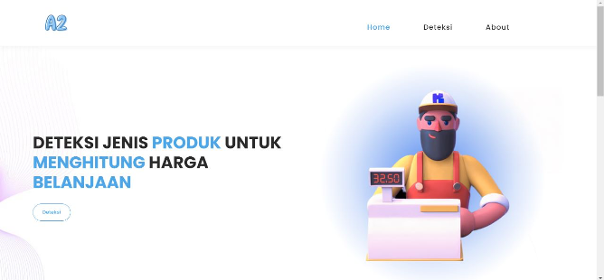
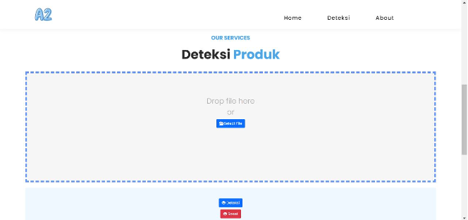
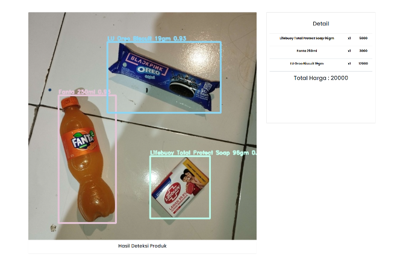

# Retail Checkout Price Detection

Sistem deteksi produk retail menggunakan YOLOv7 untuk menghitung total harga belanjaan secara otomatis.

## Overview

### Halaman Home
Halaman yang pertama kali tampil saat membuka website.



### Halaman Deteksi
Halaman untuk pengguna mengupload gambar dengan cara mengklik button select file maupun drag and drop image.



### Hasil Deteksi
Setelah klik deteksi akan tampil hasil gambar yang telah dilakukan deteksi beserta detail nama, harga setiap produk, dan total harga.



## Tech Stack

- Python 3.8+ (Ultralytics YOLOv7, OpenCV)
- PHP 7.4+
- MySQL
- Bootstrap 3

## Struktur Proyek

```
├── web/              
│   ├── index.php     
│   ├── connection.php
│   └── upload.php
├── yolo/             
│   ├── best.pt       
│   └── opencv.py     
└── app/              
```

## Instalasi

### 1. Clone & Pindahkan ke htdocs
```bash
git clone <repo-url>
cp -r retail-checkout-price-detection /xampp/htdocs/
```

### 2. Install Python Dependencies
```bash
pip install ultralytics opencv-python
```

### 3. Setup Database
```sql
CREATE DATABASE data;
USE data;

CREATE TABLE produk (
  id INT AUTO_INCREMENT PRIMARY KEY,
  nama VARCHAR(255) NOT NULL,
  harga INT NOT NULL
);

-- Contoh data
INSERT INTO produk (nama, harga) VALUES
('Fanta 250ml', 50000),
('Lifebuoy Total Protect Soap 96gm', 25000),
('LU Oreo Biscuit 19gm', 6000);
```

### 4. Konfigurasi Path
Edit `yolo/opencv.py` sesuaikan path ke lokasi instalasi.

## Cara Pakai

1. Akses `http://localhost/retail-checkout-price-detection/web/`
2. Upload gambar produk
3. Klik **Deteksi**
4. Lihat hasil & total harga

## Troubleshooting

- **Deteksi tidak jalan**: Uncomment `shell_exec` di `index.php` dan pastikan Python terinstall
- **Upload gagal**: Cek permission folder `yolo/`
- **Database error**: Pastikan MySQL running dan database `data` sudah dibuat

---